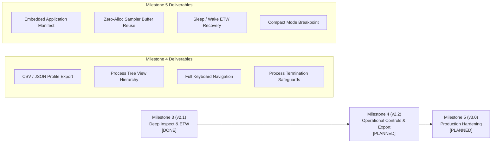

# PLAN.md: reswizz — Rust Windows Resource Dashboard & Diagnostic Profiler

## 1. Executive Summary & Objective

`reswizz` is a high-performance, native Windows system resource monitor, workload profiler, and diagnostic inspector inspired by `btop`. Built with Rust (edition 2024) and `egui`/`eframe`, it operates as a self-contained, single-binary desktop utility with **zero runtime dependencies**, **zero external network requests**, and **zero persistent disk writes**.

### Core Value Proposition
1. **Single-Page Density (btop Aesthetic)**: Instant visibility into total CPU, per-core utilization, physical/swap memory, disk I/O, network adapter throughput, and top processes.
2. **Session Profiler**: Program-level resource accumulation (core-seconds, peak/average CPU, peak memory, cumulative I/O, ETW network volume) across multiple process lifetimes, continuing uninterrupted while minimized.
3. **Deep Process Inspection**: 4-column diagnostic drawer showing parent-child hierarchy, hosted Windows services (e.g., inside `svchost.exe`), kernel vs. user CPU split, page faults/sec, fine-grained I/O counters (read/write/other), handle counts, thread counts, and active network sockets.
4. **Diagnostic Heuristics ("Findings")**: Automated, plain-language rule evaluation identifying common bottlenecks (system call thrashing, compute loops, memory leaks, handle leaks, thread pool explosions, heavy network transfers).
5. **Real-Time Kernel Network Tracing (ETW)**: Kernel-attributed per-process network bandwidth (IPv4/IPv6 TCP and UDP) via the `Microsoft-Windows-Kernel-Network` provider, with seamless unprivileged fallback and one-click UAC relaunch.

---

## 2. Strict YAGNI & Engineering Principles

These ten rules govern all design and implementation decisions. They override speculative optimizations or feature expansion.

1. **Build Only What an Acceptance Criterion Needs**: No speculative infrastructure, feature stubs, or preparatory scaffolding for hypothetical future requirements.
2. **No New Dependency if std or Under ~30 Lines Covers It**: Prefer stdlib implementations and minimal Win32 FFI bindings.
3. **No Abstraction with One Implementation**: Zero generic traits, wrappers, or factory layers unless there are at least two distinct, concurrent consumers in production code.
4. **Module Threshold >= ~300 Lines or Unsafe Win32 Code**: Start with minimal files; split only when a file exceeds readable size (~300 lines) or encapsulates an unsafe Win32 boundary (e.g., `inspect.rs`, `etw.rs`, `net.rs`).
5. **No Configuration Files or Registry Keys**: Reswizz runs entirely stateless in memory. Settings (refresh interval, filter, sort column, paused state) stay in volatile memory during the active session.
6. **No Logging Framework**: Avoid `tracing`, `log`, or file loggers. Diagnostics and system errors are surfaced directly in the UI status badges and tooltips.
7. **No Speculative Error Hierarchies**: Use standard `Option<T>` or `Result<T, String>` until callers require programmatic branching on distinct error variants.
8. **Tests Cover Pure Logic Only**: Focus automated tests on math, unit conversions, byte-order formatting, ring buffer boundaries, delta derivations, and heuristic rule evaluation. GUI rendering and live Win32 calls are verified via automated build checks and live smoke tests.
9. **Delete Before Adding**: When a metric, counter, or widget stops pulling its weight or creates visual clutter, prune it before introducing new features.
10. **The `// ponytail:` Convention**: Every deliberate engineering compromise, hardcoded heuristic threshold, or performance trade-off must be marked with a `// ponytail:` comment detailing its limitation and future migration path.

---

## 3. Technology Stack & Dependencies

| Component | Technology | Rationale |
|---|---|---|
| **Language & Edition** | Rust stable (2024 edition) | Memory safety, native performance, modern ergonomics. |
| **GUI Framework** | `eframe` / `egui` (`0.36.2`) | Immediate-mode UI, lightweight runtime, custom painted widgets. |
| **Rendering Backend** | `glow` (OpenGL) | Selected over `wgpu` to slash binary size, avoid DX12/Vulkan driver bloat, and minimize build time. |
| **System Metrics** | `sysinfo` (`0.39.6`) | Cross-platform metrics for global/per-core CPU, memory, swap, disk I/O, network adapters, and process list. |
| **Win32 Platform Interop** | `windows-sys` (`0.61.2`) | Ultra-lightweight raw FFI bindings. Zero overhead compared to the full `windows` crate. |

### Win32 Feature Set in `windows-sys`
* `Win32_NetworkManagement_IpHelper`: `GetExtendedTcpTable`, `GetExtendedUdpTable` for socket-to-PID enumeration.
* `Win32_Networking_WinSock`: `AF_INET`, `AF_INET6` protocol family constants.
* `Win32_System_Diagnostics_Etw`: `StartTraceW`, `EnableTraceEx2`, `OpenTraceW`, `ProcessTrace`, `ControlTraceW` for kernel network byte accounting.
* `Win32_System_Diagnostics_ToolHelp`: `CreateToolhelp32Snapshot`, `Process32FirstW`, `Process32NextW` for real-time process thread counts.
* `Win32_System_ProcessStatus`: `K32GetProcessMemoryInfo` for private working set, peak WS, and page fault counts.
* `Win32_System_Threading`: `OpenProcess`, `GetProcessTimes`, `GetProcessIoCounters`, `GetProcessHandleCount`, `GetPriorityClass`.
* `Win32_System_Services`: `OpenSCManagerW`, `EnumServicesStatusExW` for resolving svchost / service host bindings.
* `Win32_UI_Shell`: `ShellExecuteW` (`runas`) for one-click elevated UAC relaunch.

### Cut / Rejected Alternatives
* `egui_plot`: Cut in favor of direct `egui::Painter` custom rendering (btop style). Native painter draws high-density segmented meters and mirrored dual graphs without a charting dependency.
* Full `windows` crate: Cut in favor of `windows-sys` for faster builds and no COM/WinRT metadata overhead.
* `tokio` / `async-std`: Strictly prohibited. A dedicated OS thread with bounded channels satisfies all background sampling requirements deterministically.
* WMI / PowerShell queries: Strictly prohibited due to high latency (100–500ms) and multi-megabyte working set spikes.

---

## 4. Architecture & Module Layout

```
reswizz/
├── Cargo.toml          # Rust manifest (pinned dependencies, release strip = true)
├── Cargo.lock          # Locked dependency tree
├── README.md           # User documentation, build guide, limitations
├── PLAN.md             # Architectural specification, YAGNI rules, roadmap
└── src/
    ├── main.rs         # Application state (App), data models (Proc, Snapshot), sampler thread, channel pipeline
    ├── ui.rs           # Single-page btop UI: custom tables, segmented heat meters, sparklines, inspection drawer
    ├── profile.rs      # Session profiler: per-program accumulation, peak/average metrics, core-seconds
    ├── inspect.rs      # Deep Win32 process inspection, rate derivation, service mapping, diagnostic findings heuristics
    ├── etw.rs          # Microsoft-Windows-Kernel-Network ETW tracing session, event unpacking, byte drainage
    ├── history.rs      # Fixed-capacity O(1) circular ring buffer (VecDeque wrapper)
    └── net.rs          # IP Helper TCP/UDP socket enumeration, IPv4/IPv6 port byte-order decoders, state mapping
```

### Module Responsibilities & Architectural Boundaries

```mermaid
flowchart TD
    subgraph Background["Background Thread (Sampler)"]
        SYS["sysinfo (CPU, Mem, Disks, Nets, Procs)"]
        ETW["etw.rs (Kernel Network Bytes)"]
        NET["net.rs (IP Helper Endpoints)"]
        INSP["inspect.rs (Win32 Handles, Times, IO, Services)"]
        TOOL["ToolHelp32 (Thread Counts)"]
        
        SYS --> SNAP[Snapshot Assembly]
        ETW --> SNAP
        NET --> SNAP
        INSP --> SNAP
        TOOL --> SNAP
    end

    SNAP -->|sync_channel(1) try_send| RX["UI Receiver (App::logic)"]
    
    subgraph UIThread["UI Thread (eframe/egui)"]
        RX --> HIST["history.rs (60s Ring Buffers)"]
        RX --> PROF["profile.rs (Session Aggregator)"]
        HIST --> RENDER["ui.rs (Direct Painting)"]
        PROF --> RENDER
        
        subgraph Views["btop Layout Engine"]
            RENDER --> TOP["Top: CPU Meter & Core Grid"]
            RENDER --> SIDE["Left: Mem, Disk, Net Mirrored Graphs"]
            RENDER --> MAIN["Right: Processes / Profile / Network Tables"]
            RENDER --> DRAWER["Bottom: 4-Column Deep Inspection Drawer"]
        end
    end
```

---

## 5. Technical Specifications

### 5.1 Sampling Pipeline & Concurrency
* **Sampler Thread**: Runs independently from the GUI repaint rate. Sleeps for `interval_ms` (`Arc<AtomicU64>`, dynamic slider range 500 ms – 5000 ms, default 1000 ms).
* **Backpressure Management**: Communication uses `std::sync::mpsc::sync_channel(1)`. When the UI thread is busy or frame-locked, `try_send` drops lagging snapshots rather than queuing them, ensuring zero unbounded queue growth.
* **Repaint Signaling**: UI thread is woken reactively via `ctx.request_repaint()` upon successful delivery.
* **Selective Deep Inspection**: Deep inspection queries (`OpenProcess`, `GetProcessTimes`, `EnumServicesStatusExW`) are executed solely for the currently selected PID (`Arc<AtomicU32>`), so their cost is paid for one process only. Measured overall overhead is in §7.3.

### 5.2 Process Identity & PID Reuse Protection
In Windows, PIDs are aggressively recycled by the kernel.
* Process identity is keyed by the composite pair: `(PID: u32, StartTime: u64)`.
* If a process exits and its PID is reassigned, `find(procs, (pid, start))` fails gracefully. The inspector title shows `pid N · exited` with "Process has exited. Esc to close." No stale data from the old process is shown.

### 5.3 Normalization & Mathematical Models
* **Machine-Normalized CPU**: Standard `sysinfo` per-process CPU spans `0.0 .. (cores * 100.0)%`. To provide an intuitive metric comparable to Task Manager's total utilization, Reswizz normalizes per-process CPU to a whole-machine percentage:
  $$\text{Proc.cpu} = \frac{\text{sysinfo\_cpu}}{\max(\text{cores}, 1)}$$
* **Differential Counter Rates**: For cumulative 64-bit Win32 counters (I/O bytes, I/O operations, page faults):
  $$\text{Rate} = \frac{\text{CurrentCounter} - \text{PreviousCounter}}{\Delta t_{\text{sample}}}$$
* **Kernel vs. User CPU Breakdown**: Process execution times from `GetProcessTimes` (100 ns FILETIME units) are converted into whole-machine percentages:
  $$\text{Mode CPU \%} = \frac{\Delta \text{FILETIME}}{10^7 \times \Delta t_{\text{sample}} \times \text{cores}} \times 100.0$$
* **Session Profiler Core-Seconds**:
  $$\text{Core-Seconds} = \frac{\text{Proc.cpu}}{100.0} \times \text{cores} \times \Delta t_{\text{sample}}$$
  $$\text{Avg CPU \%} = \frac{\sum \text{Core-Seconds}}{t_{\text{elapsed}} \times \text{cores}} \times 100.0$$

### 5.4 Diagnostic Findings Engine (`inspect.rs`)
The inspector evaluates 10 real-time heuristics against the selected process to explain *why* it is consuming system resources:

| Finding Rule | Trigger Condition | Diagnostic Explanation |
|---|---|---|
| **Kernel Bottleneck** | $K > U \land (K + U) > 1.0\%$ | High kernel time: heavy system calls, file/network I/O, or device driver work rather than user application logic. |
| **Compute Loop** | $\text{CPU} > 1.0\% \land U > 1.0\% \land K < 0.2 \times \text{CPU}$ | User computation: busy loop, JIT execution, 3D rendering, or compute shader activity. |
| **Page Fault Spike** | $\text{Faults/sec} > 5,000$ | Memory thrashing, large heap allocation bursts, or extensive memory-mapped file access. |
| **Non-Disk I/O Dominance** | $\text{Other Bytes/s} > 1\text{ MiB/s} \land \text{Other} > \text{Disk}$ | Dominant "Other" I/O: high-frequency `DeviceIoControl`, named pipe IPC, or socket buffer transfers. |
| **I/O Operation Churn** | $\text{ReadOps/s} + \text{WriteOps/s} > 2,000$ | High-frequency small-packet I/O: intensive logging, database journaling, directory scanning. |
| **Rapid Memory Growth** | $\Delta \text{Mem}_{60\text{s}} > 50\text{ MiB}$ | Rapid working set expansion: memory leak candidate or heavy buffer allocation. |
| **Handle Leak** | $\text{Handles} > 10,000$ | Abnormal handle table footprint: potential leak of event, file, or thread handles. |
| **Thread Explosion** | $\text{Threads} > 300$ | Thread-pool explosion or unbounded thread spawning. |
| **Heavy Network Load** | $\text{TX} + \text{RX} > 1\text{ MiB/s}$ | Active network transfer: classified as "mostly uploading" ($\text{TX} > \text{RX}$) or "mostly downloading". |
| **Hosted Services** | Non-empty service list | Maps `svchost.exe` PIDs to exact Windows services (e.g. `wuauserv`, `Dnscache`) via SCM enumeration. |

### 5.5 ETW Kernel Tracing & Elevation Lifecycle (`etw.rs`)
* **Trace Provider**: `Microsoft-Windows-Kernel-Network` (`{7dd42a49-5329-4832-8dfd-43d979153a88}`).
* **Keywords**: `0x30` (`KERNEL_NETWORK_KEYWORD_IPV4 | KERNEL_NETWORK_KEYWORD_IPV6`).
* **Events**: TCP Send/Recv (IDs 10/11, 26/27), UDP Send/Recv (IDs 42/43, 58/59).
* **Admin Privilege Management**:
  * Unprivileged execution runs normally; ETW initialization fails with error code 5 (`ERROR_ACCESS_DENIED`), which is surfaced in the UI, not hidden.
  * Process table displays `n/a` in the network column; profile banner surfaces `per-process net: needs admin`.
  * One-click "restart as admin" executes `ShellExecuteW(..., "runas", ...)` and shuts down the unprivileged instance cleanly.
  * Orphaned sessions: `etw::stop()` forcibly terminates any pre-existing `reswizz-net` session upon launch to recover cleanly from previous unclean crashes.
* **Verification status**: The unprivileged fallback (`n/a` plus the needs-admin badge) is verified on Windows 11. **The elevated ETW path has not yet been run end to end.** The event-ID → direction mapping is unit-tested, and the event IDs and payload order were checked against the provider manifest (`wevtutil gp Microsoft-Windows-Kernel-Network /ge /gm`). Confirm by running elevated before relying on the net columns.

### 5.6 High-Performance Immediate-Mode UI (`ui.rs`)
* **Zero Widget Overhead**: Rather than allocating thousands of `egui::Label` objects across large process lists, tables are rendered using single-pass coordinate math and `egui::Painter`.
* **Virtual Scrolling**: `egui::ScrollArea::show_rows` paints only the visible rows (typically 25–40). Row data (`Vec<Row>` of strings) is still rebuilt for all processes each frame. Frame time has not been measured. // ponytail: rebuild per frame; cache rows per snapshot if profiling shows it matters.
* **Dual Mirrored Sparklines**: Disk (read up, write down) and Network (in down, out up) share a unified scale dynamically calculated from the 60-second peak.
* **Color Hierarchy**:
  * Background: `#101218`, Wells: `#161921`, Borders/Grid: `#2c313c`.
  * Accents: CPU (`#7fc88f`), Mem (`#e0b06a`), Disk (`#e07f86`), Net (`#b38fe8`), Proc (`#6fb6e0`).
  * Heat gradient: Smooth gamma-corrected interpolation from Green (`#50d080`) through Yellow (`#f0d060`) to Red (`#f05555`).

---

## 6. Project Roadmap & Milestones

### Completed Milestones

#### Milestone 1: Core Dashboard (v1.0) — [COMPLETED]
- [x] Rust 2024 Cargo project with `eframe` (glow backend) targeting Windows x64.
- [x] Bounded circular time-series ring buffer (`History`).
- [x] Background sampler thread with `sysinfo` integration.
- [x] Dynamic refresh rate slider (500 ms – 5000 ms).
- [x] btop single-page layout: top CPU box, per-core meters, memory/disk/net graphs.
- [x] Virtualized process table with search filter and multi-column sorting.
- [x] IP Helper TCP/UDP socket enumeration (`net.rs`).

#### Milestone 2: Session Workload Profiler (v2.0) — [COMPLETED]
- [x] Per-program name aggregation across multi-process lifetimes (`profile.rs`).
- [x] Cumulative core-seconds, average machine CPU %, peak CPU %, and peak memory tracking.
- [x] Profiler timeline controls: pause, resume, reset.
- [x] Background sampling continuity during window minimization via `App::logic`.
- [x] Click-to-filter transition from Profile view to Processes view.

#### Milestone 3: Deep Inspection & Kernel Tracing (v2.1) — [COMPLETED]
- [x] Low-level Win32 process inspection (`inspect.rs`): handle count, priority class, private bytes, working set, peak WS.
- [x] ToolHelp32 process thread enumeration across all running processes.
- [x] SCM service enumeration resolving `svchost.exe` process IDs to hosted Windows service names.
- [x] Microsoft-Windows-Kernel-Network ETW real-time session (`etw.rs`).
- [x] Kernel vs. User CPU time differential derivations.
- [x] Rule-based diagnostic findings heuristics engine.
- [x] 4-column expandable process inspection drawer (`details_box`).
- [x] One-click UAC administrative relaunch via `ShellExecuteW("runas")`.

---

### Upcoming Milestones & Implementation Plan



#### Milestone 4: Operational Controls & Export (v2.2) — [PLANNED, not started]
*Target: Turn Reswizz from an observational dashboard into an active operational tool with exportable diagnostic reports.*

1. **Profile & Snapshot Export (JSON / CSV)**:
   - Provide an "Export" button in the Profile view header.
   - Serialize accumulated program statistics (`by_name`) to a timestamped file: `reswizz-profile-YYYYMMDD-HHMMSS.json` or `.csv`.
   - Adhere to YAGNI: Hand-format clean CSV or JSON without adding `serde` unless structured export complexity exceeds ~40 lines.
2. **Process Hierarchy (Tree View Mode)**:
   - Toggle button `[list | tree]` in the Processes tab.
   - Build lightweight in-memory parent-child tree from `ppid` relationships.
   - Collapsible process branches with aggregated child CPU/memory rollups.
3. **Comprehensive Keyboard Navigation**:
   - `Up` / `Down` or `j` / `k`: Move row selection in active table.
   - `Enter`: Open / inspect selected process details.
   - `Esc`: Close inspector / clear filter / cancel modal.
   - `Tab` / `Shift+Tab`: Cycle through views (`Processes` $\leftrightarrow$ `Profile` $\leftrightarrow$ `Network`).
   - `/`: Immediately focus the search filter text input.
   - `Space`: Pause / resume profiler recording.
   - `q`: Graceful application quit.
4. **Process Termination Controls**:
   - "End Task" button inside the Process details drawer.
   - First attempt graceful termination via window message (`WM_CLOSE`), falling back to `TerminateProcess`.
   - Safety dialog: Confirmation popup showing PID, process name, and hosted services to prevent accidental kills of critical system components.

#### Milestone 5: Production Hardening & Packaging (v3.0) — [PLANNED]
*Target: Single-file zero-dependency distribution with native OS polish.*

1. **Embedded Windows Application Manifest**:
   - Embed `.manifest` via `build.rs` or resource script.
   - Declare DPI awareness: `<dpiAwareness>PerMonitorV2</dpiAwareness>`.
   - Declare execution level: `<requestedExecutionLevel level="asInvoker" uiAccess="false"/>` (allowing standard user start, prompting for UAC only on user demand).
2. **Buffer Allocation Optimization**:
   - Pre-allocate reusable `Vec` buffers in the background sampler loop for `procs`, `adapters`, and `endpoints` to achieve zero heap allocations in the steady-state loop.
3. **Power Management & Sleep/Wake ETW Recovery**:
   - Handle system suspend/resume events (`WM_POWERBROADCAST`). Automatically restart ETW trace session when waking from sleep or hibernation.
4. **Adaptive Compact Layout**:
   - Breakpoint for small viewport dimensions (< 1000px width or < 650px height).
   - Side panel collapses under top panel; 4-column inspection drawer adapts to a 2x2 grid.

---

## 7. Quality Assurance, Testing & Validation

### 7.1 Automated Logic Test Suite (`cargo test`)
Unit tests focus strictly on pure algorithmic logic, calculations, and buffer boundaries:

13 tests on every OS, plus 1 Windows-only live smoke test (14 under `--target x86_64-pc-windows-gnu`):

```
etw::tests::maps_event_ids_and_drains
history::tests::bounded_and_ordered
inspect::tests::derives_rates_from_two_samples
inspect::tests::findings_explain_kernel_heavy_and_services
net::tests::decodes_network_byte_order
net::tests::formats_ipv6
net::tests::maps_tcp_states
net::tests::enumerates_live_endpoints        (Windows only: live IP Helper call)
profile::tests::groups_by_name_and_accumulates
profile::tests::paused_records_nothing
tests::cpu_is_normalized_to_whole_machine
tests::reused_pid_is_not_the_same_process
ui::tests::formats_units
ui::tests::heat_spans_green_to_red
```

### 7.2 Quality Gates & Verification Commands

```bash
# 1. Strict formatting enforcement
cargo fmt --check

# 2. Strict linter enforcement (zero warnings permitted)
cargo clippy --all-targets -- -D warnings

# 3. Unit test suite (pure logic, runs natively on Linux, macOS, and Windows)
cargo test

# 4. Windows cross-compilation check (MinGW toolchain)
cargo check --target x86_64-pc-windows-gnu

# 5. Windows test execution (runs Win32 smoke tests via WSL interop or Windows host)
cargo test --target x86_64-pc-windows-gnu

# 6. Optimized release build
cargo build --release --target x86_64-pc-windows-gnu
```

### 7.3 Performance Budgets

Measured 2026-10-11 on Windows 11 x64 (20 logical cores, ~344 processes) with the release build, the default 1000 ms refresh, the window visible, and no elevation. Measurement: `Get-Process` readings at about 9 s and 61 s after launch.

| Metric | Budget | Measured | Status |
|---|---|---|---|
| **Working Set** | $< 35\text{ MiB}$ | ~121 MiB (private: ~58 MiB) | **Over budget.** Most of it is likely the OpenGL driver and font atlas; not yet profiled. |
| **CPU at 1000 ms refresh** | $< 0.5\%$ of machine | ~0.15% of machine (~2.9% of one core) | Within budget |
| **Release Binary Size** | $< 10\text{ MiB}$ (stripped) | 14.5 MB (13.8 MiB) | **Over budget.** Next step: `opt-level = "z"`, `lto = true`, `codegen-units = 1`, `panic = "abort"`. |
| **UI Frame Render Time** | $< 4.0\text{ ms}$ | Not measured | Unknown |
| **Startup to First Frame** | $< 300\text{ ms}$ | Not measured | Unknown |

---

## 8. Acceptance Criteria

Every milestone release of Reswizz must satisfy the following criteria:

1. **Native Execution**: Runs as a single `.exe` on Windows 10 and Windows 11 x64 without external runtime prerequisites (no WebView2, no VC++ redistributable, no .NET).
2. **Responsive Immediate-Mode UI**: UI frame rate remains fluid and responsive regardless of process count (500+ processes) or sampling interval.
3. **Accurate Machine CPU Normalization**: Whole-machine CPU percentage never exceeds 100.0%, correctly scaled by logical core count.
4. **Bounded Memory Invariant**: Historical time series maintain $O(1)$ capacity; resident memory footprint remains flat after hours of continuous execution.
5. **Robust PID Reuse Handling**: Exited or recycled processes never cause null dereferences, crashes, or metric leakage between different processes.
6. **Socket vs. Throughput Clarity**: Open sockets in the Network tab are explicitly labeled as connection endpoints, preventing confusion with byte throughput.
7. **Graceful Administrative Fallback**: Functions cleanly without elevation; ETW network monitoring and deep inspection features handle `ERROR_ACCESS_DENIED` cleanly with explanatory badges and one-click UAC relaunch.
8. **ETW Session Hygiene**: Kernel ETW trace sessions are cleanly terminated on exit, and orphaned sessions from previous application crashes are automatically cleaned up on launch.
9. **Zero Network / Disk Footprint**: Does not initiate any network connections, phone home, or write unsolicited configuration/telemetry files to the host machine.
10. **Zero Clippy Warnings & 100% Test Pass Rate**: `cargo clippy --all-targets -- -D warnings` and `cargo test` pass with zero errors and zero warnings.
